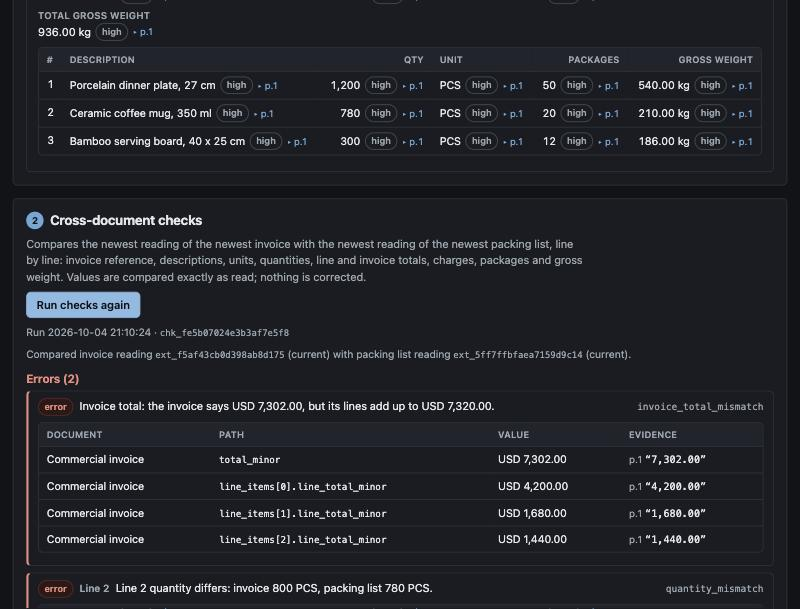
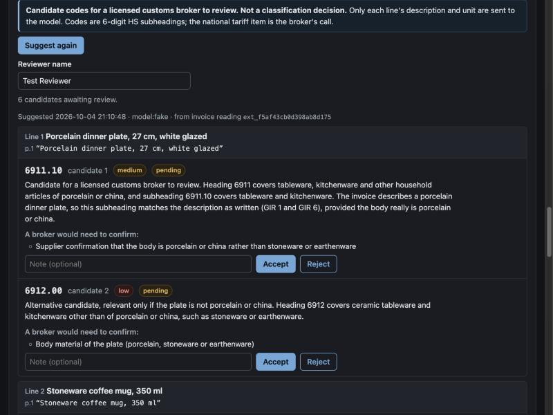
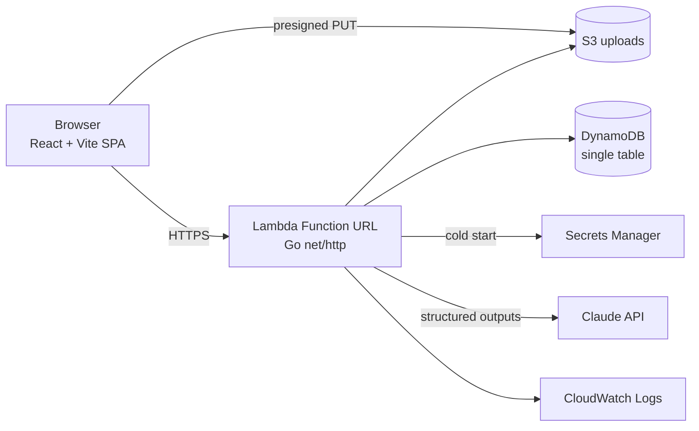

# TradeDoc Check

An AI-assisted review tool for import paperwork. Upload a **commercial invoice**
and its **packing list**; Claude reads both into a strict schema where every
value carries its page and the exact text it was read from; deterministic Go
code compares the two documents line by line; Claude proposes **candidate
codes for a licensed customs broker to review**; a named person accepts or
rejects each candidate and signs the shipment off. Every step lands in an
append-only audit trail.

Go · React + Vite · Claude API (structured outputs) · AWS Lambda, S3, DynamoDB,
Secrets Manager, CloudWatch · Terraform



## Why: the process it changes

| Today (manual) | With TradeDoc Check |
|---|---|
| A clerk retypes invoice and packing-list fields into the broker's system | The model drafts the fields; each value shows its confidence and the quote it came from, so checking is reading, not retyping |
| Totals and quantities are compared by eye, if at all | Go code recomputes line totals, sums, packages and weights exactly and lists every disagreement with both sides' evidence |
| Classification starts from a blank search | The model offers 2–3 ranked 6-digit HS candidates per line, with the heading reasoning and the facts a broker still has to confirm |
| Decisions live in email | Accept/reject decisions and the final sign-off are recorded per person, against the exact readings and check run they were based on |

The model never decides anything: it drafts, the code checks, a person decides.

## What it checks

Pairs invoice and packing-list lines by position and reports findings with a
severity (`error` must be resolved or explained before approval):

| Code | Severity | Meaning |
|---|---|---|
| `invoice_ref_mismatch` | error | packing list quotes a different invoice number |
| `quantity_mismatch` | error | same unit, different quantity (exact decimal comparison) |
| `line_total_mismatch` | error | quantity × unit price ≠ line total (exact maths, ±1 minor unit for seller rounding) |
| `invoice_total_mismatch` | error | goods lines + freight + insurance + other − discount ≠ printed total |
| `line_missing` | warning | a line exists on one document only |
| `description_mismatch` | warning | descriptions share < 50% of words: lines may be misaligned |
| `description_differs` | info / **warning** | words on one side only; raised to warning for material words (e.g. "stoneware" vs "ceramic"), because material decides the heading |
| `unit_mismatch` | warning | different units (spellings of the same unit, e.g. KGS/KG, are merged) |
| `package_total_mismatch`, `weight_total_mismatch` | warning | packing-list lines don't add up to its printed totals |
| `freight_insurance_not_shown` | info | C/D-group Incoterm but no freight/insurance amounts: Australia values imports on an FOB basis, so the broker may need the split |
| `low_confidence`, `not_checked` | info | a check relied on a low-confidence value, or couldn't run because a value is missing |

Values are compared exactly as printed: nothing is corrected. If an invoice
prints a wrong total, the extraction keeps the wrong total and the check says so.



## Design decisions

- **Every value carries evidence.** `Field[T]` = value + confidence
  (`high`/`medium`/`low`, the model's own rating, not a calibrated probability) +
  page + exact quote. `null` means "not on the document"; the model must not guess.
- **Numbers never go through floats.** Totals are integer minor units (with ISO
  4217 exceptions such as JPY 0 and KWD 3 decimals); quantities and unit prices
  stay as the printed decimal strings (`"1250.5"`, `"0.385"`) and are multiplied
  with `math/big`, rounding half-up once.
- **Schema validation is a feedback loop.** Claude answers through structured
  outputs; Go then runs the domain `Validate()`. If that fails, the errors
  (`line_items[1].quantity: must be …`) go back into the same conversation for
  one corrected attempt. It stops early when retrying can't help (only
  "required" values missing, output cut off, input too large).
- **Built to the API's real limits.** Structured outputs allow at most 16
  union-typed parameters; a nullable-per-field schema had 39. Each field is
  sent as `{found, value, confidence, evidence}` instead, and a test walks
  every schema to enforce the documented limits.
- **Candidates, not classifications.** Only 6-digit HS subheadings are
  suggested; the national item (in Australia the 8-digit Schedule 3 tariff
  classification plus its 2-digit statistical code) is the broker's call.
  Confidence is only ever `medium` or `low`, because an invoice description is
  the seller's unverified declaration. One accepted candidate per line.
- **Data minimisation.** The classifier receives each line's description and
  unit only: no prices, parties, quantities or origin (origin affects duty and
  preference, never the heading).
- **Append-only and stale-proof.** Readings, check runs, decisions and
  sign-offs are never edited. A sign-off is refused if the documents were read
  again after the check run, or if the reviewed codes came from an older
  invoice reading.
- **Human gates.** Approving a run that has errors requires a written reason;
  approving with unreviewed candidates is refused.

## Security

| Risk | Control |
|---|---|
| Malicious or oversized uploads | Type and size declared up front (PDF/PNG/JPEG, 10 MiB, images 5 MiB); after upload the server checks the stored size, sniffs the bytes and hashes the file; mismatches are deleted. The file is re-hashed before it is sent to the model |
| Upload bypassing the API | Browser uploads straight to S3 with a 5-minute presigned PUT whose content type and length are signed; locally an HMAC-signed URL mimics the same flow |
| Prompt injection in documents | Documents and descriptions are declared untrusted data; the model has no tools; output is schema-constrained and validated, so the worst case is a wrong value that a person sees with its quote |
| Cost abuse | Per-IP token buckets (per instance), plus per-IP and global daily model quotas kept in DynamoDB with atomic conditional writes, so they hold across Lambda instances; input tokens counted (free endpoint) before any paid call |
| Leaking data through logs | Logs record the route pattern, status and timings only: no bodies, document text, prompts, model output, keys, IDs or presigned URLs. Audit details hold IDs, counts and labels |
| Secrets | Anthropic key lives in Secrets Manager, read once at cold start; never in Terraform state, env files or logs |
| Browser attacks | Strict CSP (`default-src 'self'`, no inline scripts or styles), `nosniff`, `frame-ancestors 'none'`, HSTS, no `dangerouslySetInnerHTML` |
| Over-broad AWS access | IAM role lists exact actions on exact ARNs; bucket is private, TLS-only, SSE-S3, CORS for the app origin only; demo data expires after 30 days (S3 lifecycle, DynamoDB TTL) |

There is no login: this is a demo for synthetic documents. A shipment is
reachable only through its unguessable 80-bit ID, and there is deliberately
no "list all shipments" route.

## Architecture



One Go binary serves both the API and the embedded SPA. Locally it runs as a
normal HTTP server with an in-memory store and disk uploads; on AWS the same
handler runs on Lambda via `lambdaurl`. App Runner is not used: it stopped
accepting new customers on 30 April 2026, and Lambda costs nothing while idle.

## Run it locally

Needs Go 1.26 and Node 22.

```bash
make web        # build the frontend (embedded into the Go binary)
make run-fake   # http://localhost:8080 with canned model answers, no API key needed
```

If port 8080 is busy: `ADDR=:8090 make run-fake`.

Open the page and click **Load sample A**. In fake mode the model returns the
sample A readings for any file, and the UI says so. With a real key:

```bash
export ANTHROPIC_API_KEY=...
make run
```

`make test` runs `go vet` and every Go test with the race detector. The store
conformance suite also runs against DynamoDB Local when `DYNAMODB_ENDPOINT` is
set (see `internal/store/dynamo_test.go`); `cd web && npx vitest run` runs the
frontend tests.

The synthetic documents live in `samples/` (`make samples` regenerates them).
Sample A has four deliberate problems: a mistyped invoice total, a quantity
shortfall on one line, a wrong package total, and stoneware described as
ceramic. Sample B is consistent.

## Deploy to AWS

Needs Terraform ≥ 1.6, the AWS CLI v2 with credentials, `zip`, and an
Anthropic API key, ideally from a dedicated workspace with a monthly spend
limit set in the Anthropic Console.

```bash
make tf-init
make deploy                       # builds web + lambda.zip, then terraform apply
export ANTHROPIC_API_KEY=...
make set-secret                   # pipes the key into Secrets Manager; never echoed
```

Until `set-secret` has run, the function fails at cold start (502): that is
expected. Then open the `function_url` output. `make destroy` removes
everything, including uploads.

Cost: idle cost is about US$0.40/month (one secret); Lambda, DynamoDB
on-demand and S3 stay in the free tier at demo traffic. Model spend is capped
by `model_calls_per_day` (default 25 operations, each at most two requests of
≤ 60k input tokens); the workspace spend limit is the hard backstop.

Environment variables read by `cmd/api`: `STORE` (`memory`|`dynamodb`, with
`TABLE_NAME`), `BLOB` (`local`|`s3`, with `DATA_DIR` or `BUCKET_NAME` +
`UPLOAD_ORIGIN`), `MODEL_PROVIDER` (`claude`|`fake`|`off`), `ANTHROPIC_API_KEY`
or `ANTHROPIC_SECRET_ARN`, `CLAUDE_MODEL` (default `claude-opus-5-5`),
`CLAUDE_EFFORT` (`medium`), `CLAUDE_MAX_INPUT_TOKENS` (60000),
`MODEL_CALLS_PER_DAY` (25), `LOCAL_UPLOAD_SECRET`, `FAKE_FIXTURES_DIR`,
`DYNAMODB_ENDPOINT` (local testing only), `ADDR`.

## API

Errors are always `{"error": {"code", "message", "details"}}`.

| Method | Path | Purpose |
|---|---|---|
| GET | `/healthz`, `/v1/config` | liveness; model, upload limits, currency minor units |
| POST / GET | `/v1/shipments`, `/v1/shipments/{id}` | create / read a shipment |
| POST | `/v1/shipments/{id}/uploads` | declare a file, get a presigned upload |
| POST | `/v1/documents/{id}/complete` | verify the uploaded file (size, sniffed type, SHA-256) |
| GET | `/v1/shipments/{id}/documents` | list documents |
| POST | `/v1/documents/{id}/extract` | read the document with Claude (validated, append-only) |
| POST / GET | `/v1/documents/{id}/extractions` | submit a manual correction / list all readings |
| POST / GET | `/v1/shipments/{id}/checks` | compare the newest readings / list check runs |
| POST / GET | `/v1/shipments/{id}/suggestions` | candidate codes for the newest invoice reading / list |
| POST | `/v1/suggestions/{id}/review` | accept or reject one candidate (final) |
| POST / GET | `/v1/shipments/{id}/signoffs` | sign off a check run / list sign-offs |
| GET | `/v1/shipments/{id}/audit` | audit trail |

## Limitations and next steps

- **Document length.** One model pass handles roughly 30–40 lines; longer
  documents get `document_too_large`. Next: streaming plus page-by-page extraction.
- **Candidates are not grounded in tariff text.** The model works from the
  HS nomenclature it learned. Next: retrieve the relevant chapter notes and
  the ABF Working Tariff entries and cite them.
- **No evaluation set yet.** Two synthetic document pairs exercise the
  workflow; they say nothing about how well the model reads real documents.
  A labelled set of real (redacted) documents would come before any production use.
- **Line pairing is positional.** Documents that order goods differently are
  flagged (`description_mismatch`) rather than re-paired.
- **No authentication or multi-tenancy:** demo only.

## Layout

```
cmd/api/            config, wiring, local server or Lambda
internal/domain/    schema and validation (no I/O)
internal/ai/        model interfaces + fake used offline and in tests
internal/claude/    Claude client, prompts, structured-output schemas
internal/checks/    invoice vs packing list (pure functions)
internal/httpapi/   routes, handlers, rate limits, security headers
internal/store/     Store interface, in-memory and DynamoDB, shared conformance suite
internal/blob/      local HMAC-signed uploads and S3 presigned uploads
internal/secrets/   Secrets Manager
internal/webui/     embedded SPA handler
web/                React + Vite + TypeScript frontend
samples/            synthetic PDFs, hand-checked expected readings
deploy/terraform/   AWS stack
docs/               design notes and screenshots
```
